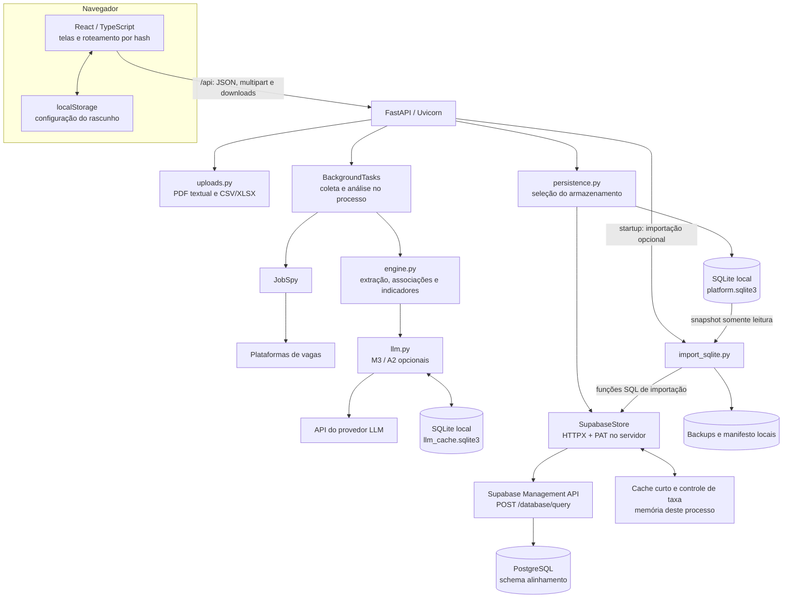
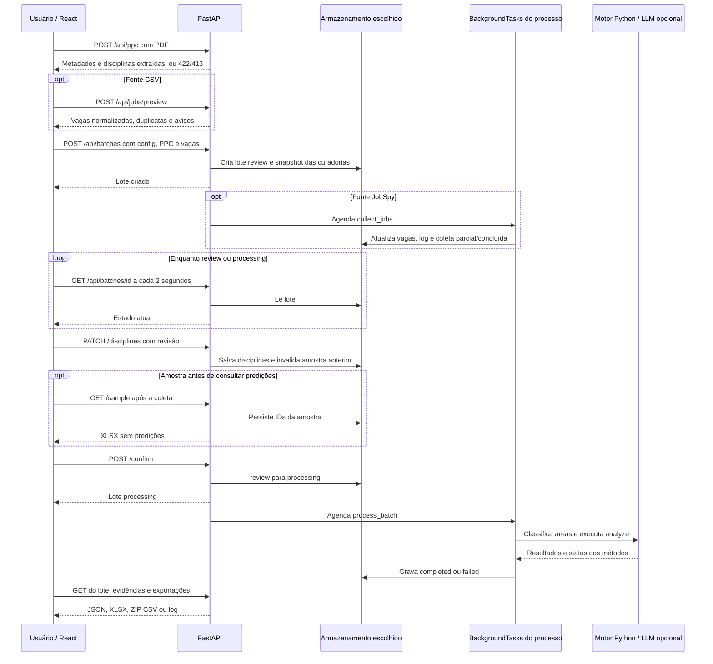

# Auditoria de arquitetura e fluxos

Base da leitura: commit **`8300112985bbc873116182feaa4dd3c772677841`** (`8300112`). As referências abaixo apontam para esse commit, com arquivo, função e linhas. A análise foi estática: não iniciou a aplicação, executou testes, abriu bancos locais ou consultou serviços externos. Não atesta a configuração ou disponibilidade atual do Supabase, JobSpy ou provedor LLM. Não foi encontrado `AGENTS.md` no checkout ou nos ancestrais pesquisados em `/workspace`.

A verificação da instância remota está documentada separadamente em [Persistência Supabase](persistencia-supabase.md) e [Estado e evidências](estado-e-evidencias.md). Esses relatórios distinguem os objetos efetivamente observados no serviço das declarações de arquitetura descritas aqui.

## 1. Visão geral

A plataforma é uma aplicação React/TypeScript com uma API FastAPI/Python. O navegador envia arquivos e JSON à API e recebe lotes, evidências e downloads. O código do frontend não realiza integração de dados com Supabase, plataformas de vagas ou LLM diretamente. A API concentra extração documental, coleta, cálculo, validação e persistência. Links para anúncios podem abrir o site externo por ação do usuário; isso não é a coleta automatizada da aplicação.

Em desenvolvimento, Vite serve a interface e encaminha `/api` ao Uvicorn. No modo `npm start`, Uvicorn serve tanto a API quanto os arquivos compilados de `dist`. O roteamento da interface usa fragmentos da URL, como `#/lotes/12/dashboard`; não depende de uma rota de backend para cada tela.

Evidências: [src/api.ts:1–15 — `api`, `upload`, `post`][frontend-api]; [src/App.tsx:15–40 — `parseRoute`, `navigate`, efeitos de conexão e polling][frontend-app]; [vite.config.ts:9–17 — proxy `/api`][vite]; [server/app.py:604–607 — montagem de `StaticFiles`][app-static].

As setas para serviços externos representam integrações implementadas no código; não demonstram que essas integrações foram executadas nesta auditoria. A alternativa SQLite e a alternativa Supabase não constituem uma replicação contínua entre bancos.

## 2. Responsabilidades e estado

| Camada | Responsabilidade e estado mantido | Referência |
| --- | --- | --- |
| React | Telas de nova análise, revisão, processamento, painel, evidências e validação. Mantém o lote aberto em memória, filtros e edição local. Salva apenas a configuração do rascunho em `localStorage`. | [src/App.tsx:17–45 — `App`][frontend-app]; [src/pages/NewAnalysis.tsx:7–35 — `readDraft`, uploads e `run`][new-analysis] |
| API | Valida entradas, verifica transições do lote, chama os módulos Python e filtra a representação pública. Mantém uma instância de armazenamento e o estado de inicialização por processo. | [server/app.py:53–123 — `_raw_store`, `store`, `initialize_persistence`, middleware e handlers][app-store]; [server/app.py:133–135 — `public_batch`][app-public] |
| Uploads | Extrai texto e disciplinas do PDF, interpreta tabelas, normaliza vagas e remove duplicatas. Os handlers devolvem JSON, sem criar um arquivo original persistente da aplicação. | [server/uploads.py:20–172 — `read_upload`, `segment_ppc`, `read_tables`, `deduplicate_jobs`, `parse_jobs`][uploads] |
| Coleta e processamento | Funções síncronas executadas como tarefas de background. Gravam progresso e resultados no mesmo armazenamento acessível pela API. | [server/app.py:333–345 — `create_batch`][app-create]; [server/app.py:378–392 — `confirm_batch`][app-confirm]; [server/app.py:424–542 — `collect_jobs`, `process_batch`][app-workers] |
| Motor de análise | Opera sobre os textos e a configuração do lote, reconstrói o dicionário a partir do inventário do código e das curadorias congeladas, e devolve resultados, predições por método, evidências, fórmulas e fingerprint das entradas. | [server/engine.py:277–420 — `analyze`][engine-analyze] |
| LLM | Faz chamadas reais opcionais para M3/A2; limita tentativas e orçamento, valida citações e conserva respostas elegíveis em cache SQLite local. | [server/llm.py:87–216 — `LLMClient`, `_invoke`][llm-client] |
| Persistência | Expõe `create`, `get`, `all`, `update`, `dictionary_edits` e `add_dictionary_edit` por adaptadores SQLite ou Supabase. | [server/storage.py:14–65 — `Store`][sqlite-store]; [server/supabase_store.py:281–365 — operações de `SupabaseStore`][supabase-crud] |
| Relatórios | Gera XLSX/ZIP CSV, amostra sem predições e métricas a partir das anotações importadas. | [server/reporting.py:24–117 — serialização, exportações e `make_sample`][reporting-exports]; [server/reporting.py:131–247 — importação e validação][reporting-validation] |

`public_batch` retira `annotations`, `dictionary_snapshot` e `sample` da resposta JSON. O lote público ainda contém textos de disciplinas e vagas, resultados, predições, evidências e logs. A amostra e os rótulos humanos completos ficam no documento persistido, não na resposta pública comum.

## 3. Fluxo de uma análise

### 3.1 Preparação e criação

`NewAnalysis.onPdf` envia o PDF imediatamente para `/ppc`. O retorno fica no estado React; `run` reenvia esse JSON no campo `ppc` de `/batches`. Portanto, o upload não cria um asset persistente identificado por um token de arquivo. O lote conserva os textos extraídos/revisados e metadados, não os bytes originais do PDF. O preview de vagas segue o mesmo padrão: sua normalização precede a criação persistente do lote.

`new_batch` atribui `status=review`, conserva configuração, disciplinas, vagas, logs, contadores e seis marcadores de etapa. Também congela as edições de dicionário disponíveis naquele momento. Curadorias posteriores são acrescentadas ao armazenamento e afetam o próximo lote, não recalculam o lote existente.

O campo `dictionary_snapshot` contém **as edições de curadoria**, não uma cópia autossuficiente do vocabulário completo. `build_dictionary` combina essas edições com `DICTIONARY` da versão do código em execução. Reproduzir a análise após mudanças no inventário exige preservar o commit e arquivar o dicionário efetivo, além do lote.

Evidências: [src/pages/NewAnalysis.tsx:27–35 — `onPdf`, `onCsv`, `run`][new-analysis]; [server/app.py:217–226 — handlers dos uploads][app-uploads]; [server/app.py:303–345 — `new_batch`, `create_batch`][app-new-batch]; [server/app.py:204–214 — `edit_dictionary`][app-dictionary].

### 3.2 Revisão e amostra cega

Durante `review`, o usuário corrige disciplinas e bibliografia. O frontend salva o estado antes de confirmar ou baixar a amostra se houver alterações pendentes. A API recusa edição após o lote sair de `review`; cada edição invalida a amostra anterior.

`GET /sample` exige vagas e coleta encerrada, e aceita lotes em revisão ou concluídos. A seleção é determinística por área, usa até 60 vagas, no máximo 12 por área, todas as disciplinas e até 100 pares. Inclui título + descrição das vagas e ementa + objetivos do PPC, sem preencher as respostas dos métodos. Baixar antes da confirmação é uma possibilidade efetiva da interface de revisão; o código não obriga o usuário a realizar a anotação antes de abrir resultados posteriormente.

Evidências: [src/pages/Review.tsx:76–122 — `save`, `confirm`, `downloadBlindSample`][review]; [server/app.py:364–392 — edição e confirmação][app-review]; [server/app.py:569–579 — `sample_batch`][app-sample]; [server/reporting.py:86–117 — `make_sample`][reporting-sample].

### 3.3 Coleta e cálculo

`collect_jobs` consulta uma plataforma e os termos configurados. Converte o raio de quilômetros para milhas ao chamar JobSpy, solicita descrições, tenta cada consulta até três vezes e faz pausas entre tentativas/termos. Vagas sem título ou descrição não entram. A deduplicação considera URL, identificador externo com a fonte e título + empresa + cidade normalizados. Se a meta não for atingida, o lote registra coleta parcial com as vagas obtidas; não fabrica vagas para completar a meta.

Confirmar exige `review`, coleta parada e pelo menos uma vaga. `process_batch` registra classificação por área, chama `analyze` e salva os resultados se o estado ainda for `processing`. Os marcadores de extração, associação, classificação e indicadores são apresentados como etapas, mas não representam processos independentes: classificação ocorre antes de `analyze` e a conclusão de várias etapas é gravada conjuntamente. A duração registrada na extração é o tempo acumulado de `process_batch`, não uma medição exclusiva desse método.

M1/M2 e A1 produzem a análise lexical. M3 e A2 dependem de configuração do provedor no servidor; a presença da chave indica configuração, não execução bem-sucedida. O motor apresenta as saídas LLM separadamente e não substitui as definições lexicais de I2/I4 por um julgamento LLM. Os status e as pendências distinguem métodos executados, desabilitados, descartados ou interrompidos por falha/orçamento.

Evidências: [server/app.py:424–490 — `collect_jobs`][app-collection]; [server/uploads.py:123–146 — `deduplicate_jobs`][jobs-dedup]; [server/app.py:493–542 — `process_batch`][app-processing]; [server/engine.py:187–274 — `_run_llm`][engine-llm]; [server/engine.py:277–420 — `analyze`][engine-analyze]; [server/llm.py:46–57 — `llm_status`][llm-status].

### 3.4 Evidências, anotação e exportação

Uma decisão humana sobre associação é metadado persistido: aceitar/rejeitar não altera os indicadores automáticos daquele lote. As anotações de validação são outro fluxo: um arquivo do primeiro ou segundo anotador precisa referenciar os IDs da amostra salva. Somente depois da anotação primária surgem métricas. M3/A2 incompletos restringem a comparação ao suporte comum efetivamente processado; ausência por falha ou orçamento não vira automaticamente um negativo. A concordância entre anotadores usa os rótulos comuns.

As exportações de resultados exigem `completed`. XLSX contém uma aba por tabela; CSV é entregue como ZIP com um arquivo por tabela. Fórmulas iniciadas por caracteres de planilha são neutralizadas por `safe_cell`; textos são limitados a 32.760 caracteres por célula nesse serializador, inclusive no CSV. Downloads são montados em memória e usam `Cache-Control: no-store`; não formam um repositório de arquivos gerados no servidor.

Evidências: [server/app.py:410–421 — `save_decision`][app-decisions]; [server/app.py:545–593 — exportação, amostra e anotações][app-outputs]; [server/reporting.py:24–64 — `safe_cell`, `workbook`, `csv_archive`][reporting-exports]; [server/reporting.py:179–247 — `validation_result`][reporting-validation].

## 4. Contratos e limites observáveis no código

| Entrada ou operação | Saída e limites implementados | Referência |
| --- | --- | --- |
| `POST /api/ppc`, multipart `file` | Até 20 MiB; PDF com até 500 páginas e 3 milhões de caracteres extraídos. Recusa senha, conteúdo inválido e menos de 80 caracteres após remoção de `\W`. Segmenta por cabeçalhos; se não reconhecer o formato, devolve trechos por página com alerta. Não realiza OCR. | [server/uploads.py:16–93 — `read_upload`, `segment_ppc`][uploads] |
| `POST /api/jobs/preview` | CSV ou XLSX no backend; usa a primeira folha para vagas. Até 2.000 linhas, título e descrição obrigatórios, células com até 100 mil caracteres. XLSX tem teto de 60 MiB descompactados; CSV aceita UTF-8 com BOM ou CP1252, delimitado por vírgula ou ponto e vírgula. A seleção de arquivos da tela oferece CSV. | [server/uploads.py:96–172 — `read_tables`, `parse_jobs`][upload-tables]; [src/pages/NewAnalysis.tsx:49 — seletor CSV][new-analysis-csv] |
| `POST /api/batches` | JSON com `config`, `ppc` e `jobs`. Até 2.000 vagas, de 1 a 400 disciplinas, campos textuais principais limitados a 100 mil caracteres. Não há neste handler um teto global em bytes para o JSON inteiro. | [server/app.py:229–308 — modelos e validações][app-validation] |
| Configuração | Raio 0–500 km na API; meta 1–2.000; limiar 0–100%; orçamento LLM 0–10.000; de 1 a 20 termos com até 120 caracteres, salvo demo, que admite lista vazia. O campo de raio na tela oferece máximo de 200 km. | [server/app.py:250–274 — `validate_config`][app-validation]; [src/pages/NewAnalysis.tsx:48 — campos][new-analysis-csv] |
| Coleta JobSpy | Até três tentativas por termo; até 500 resultados solicitados por chamada; quantidade final limitada à meta. Disponibilidade externa e atendimento do recorte dependem da fonte. | [server/app.py:424–478 — `collect_jobs`][app-collection] |
| LLM | JSON de entrada de cada chamada limitado a 60 mil caracteres; timeout padrão 45 s; até duas repetições e orçamento incluindo tentativas. Cache elegível não consome uma nova chamada. | [server/llm.py:94–216 — `LLMClient.__init__`, `_invoke`][llm-client] |
| Anotações | Upload sujeito aos mesmos 20 MiB; leitura tabular configurada para até 100.001 linhas por folha; valida cabeçalhos, IDs, duplicatas e rótulos. Células de resposta em branco são ignoradas. | [server/reporting.py:131–160 — `import_annotations`][reporting-import] |
| Exportações | `format=xlsx` ou `csv`; tabelas `indicators,gaps,disciplines,jobs,associations,validation`. `gaps` respeita o limiar configurado. Amostra e log têm rotas próprias. | [server/app.py:556–601 — handlers][app-outputs]; [server/reporting.py:67–82 — `export_tables`][reporting-tables] |

Esses são limites de leitura/validação do aplicativo. O limite de 20 MiB é verificado depois que o framework recebeu o multipart; não equivale, por si só, a um limite de ingresso HTTP configurado em proxy. A heurística de texto do PDF não garante segmentação curricular correta; a revisão é parte do fluxo.

## 5. Persistência, cache e importação

### 5.1 Seleção e disponibilidade

`TCC_STORAGE_BACKEND` aceita `auto`, `sqlite` ou `supabase`. Em `auto`, a presença de `SUPABASE_ACCESS_TOKEN` **ou** `SUPABASE_PROJECT_REF` seleciona Supabase; sem ambos, seleciona SQLite. A referência padrão vem de `supabase/project.json`, mas esse arquivo sozinho não ativa o modo remoto. `TCC_DATA_DIR` muda o diretório local; o padrão é `.tcc-data` no projeto.

Uma falha remota não faz o backend passar a gravar silenciosamente no SQLite. O startup verifica o armazenamento, pode executar a importação local e conserva um erro de persistência se não concluir. Requisições `/api/` tentam inicializar novamente de forma serializada e devolvem 503 enquanto o problema persistir. Conflitos CAS usam 409. A interface estática pode continuar acessível nesse estado.

Evidências: [server/persistence.py:16–42 — `storage_options`, `build_store`, `storage_description`][persistence]; [server/settings.py:8–10 — `data_directory`][settings]; [server/app.py:79–123 — inicialização e tratamento de indisponibilidade][app-initialize].

### 5.2 Forma dos dados e concorrência

Os adaptadores guardam o documento completo do lote, com disciplinas, vagas, resultados, rótulos, amostra, logs e configuração; não há uma tabela relacional por entidade de domínio. Edições do dicionário são documentos separados. No SQLite, o corpo é JSON serializado em `TEXT`, com WAL e `RLock` da instância. Esse lock não é um mecanismo de coordenação entre processos.

No Supabase, a migração declara `alinhamento.batches`, `alinhamento.dictionary_edits` e `alinhamento.sqlite_imports`. O adapter chama a **Management API**, não PostgREST e não o SDK de frontend. O PAT é enviado pelo servidor em `Authorization`; os dados ficam em parâmetros vinculados às consultas SQL. Criações usam UUID de requisição e funções idempotentes. Atualizações leem corpo + revisão e escrevem com `WHERE id = ... AND revision = ...`, repetindo até cinco conflitos sobre snapshots novos. Isso protege contra sobrescrita concorrente do documento; não implementa uma fila distribuída de tarefas.

Evidências: [server/storage.py:17–65 — armazenamento local][sqlite-store]; [server/supabase_store.py:68–113 — configuração e transporte][supabase-config]; [server/supabase_store.py:190–252 — `query`, `_query`][supabase-query]; [server/supabase_store.py:281–365 — CRUD, UUID e CAS][supabase-crud]; [supabase/migrations/20261106004032_create_alinhamento_store.sql:4–49 — schema e tabelas declarados][migration]. A aplicação efetiva dessa migração no serviço remoto deve ser verificada em evidência separada.

### 5.3 Onde ficam os caches e backups

| Estado | Local e alcance | Comportamento |
| --- | --- | --- |
| Rascunho da configuração | `localStorage` do navegador | Não inclui um backup do PDF ou dos lotes; não sincroniza entre navegadores. |
| Cache de lote/dicionário remoto | Memória de cada `SupabaseStore` | TTL padrão 0,4 s, limitado a 0,5 s; devolve cópias profundas. Escritas invalidam caches locais. Não há invalidação por mensagem entre servidores. |
| Controle de taxa remoto | Memória do processo, compartilhada entre instâncias para o mesmo projeto | Intervalo padrão de 0,65 s entre tentativas; considera `Retry-After`/reset e cooldown de até 60 s por espera. Não coordena outros processos ou consumidores do mesmo PAT. |
| Cache LLM | `TCC_DATA_DIR/llm_cache.sqlite3` | Respostas elegíveis indexadas por hash de versão de prompt, modelo, provedor, método e entrada. Citações são reconferidas no cache. Continua local mesmo quando os lotes usam Supabase. |
| Origem SQLite | `TCC_DATA_DIR/platform.sqlite3` | Permanece após importar; não é mantida sincronizada com novas gravações remotas. |
| Backup anterior à importação | `TCC_DATA_DIR/backups/` | Cópia consistente antes da primeira escrita de cada execução de importação aplicada; não é um backup periódico do Supabase. |
| Manifesto de importação | `TCC_DATA_DIR/import-state/` | Conserva a identidade da origem para reexecuções; os recibos remotos reconhecem linhas já copiadas. |
| Dependências e ambiente Python antigo | `.cache/`, ou `TCC_CACHE_DIR` | Caches de npm/uv/pip e `venv-backups` do setup; não são backups dos dados acadêmicos. |

Evidências: [server/supabase_store.py:28–173 — gate e tratamento de taxa][supabase-rate]; [server/supabase_store.py:277–354 — caches e invalidações][supabase-cache]; [server/llm.py:108–113 e 137–202 — arquivo e chave do cache][llm-cache]; [server/import_sqlite.py:83–143 — manifesto e backup][import-backup]; [scripts/setup.sh:4–35 — caches e preservação da `.venv`][setup]. Os 60 s de cooldown não são um deadline global da requisição: retries, latência e concorrência podem prolongar o atendimento.

### 5.4 Importação SQLite → Supabase

No startup remoto, se `platform.sqlite3` existir e `TCC_IMPORT_SQLITE` não for `off`, `initialize_persistence` chama `import_sqlite_snapshot(..., apply=True)`. A ferramenta de linha de comando, por outro lado, é somente inspeção por padrão e exige `--apply` para escrever.

O importador abre a origem somente para leitura, cria um snapshot consistente via SQLite backup, verifica integridade e interpreta os dois conjuntos de documentos. Antes de escrever remotamente, salva backup e, quando necessário, manifesto local. Cada linha recebe fingerprint e UUID determinístico; funções SQL guardam o mapeamento de IDs e reconhecem importações repetidas. Uma falha pode deixar linhas remotas já importadas; o startup bloqueia o acesso normal à API até a importação concluir. A reexecução usa recibos para continuar, em vez de tratar o lote inteiro como uma única transação.

Não há exclusão da origem, replicação reversa, rotina de retenção dos backups ou backup remoto agendado nesses arquivos. Se a origem local já importada for modificada, o tratamento de conflito preserva os registros existentes em vez de sobrescrevê-los automaticamente.

Evidências: [server/app.py:89–98 — importação no startup][app-import]; [server/import_sqlite.py:37–79 — snapshot e leitura][import-read]; [server/import_sqlite.py:146–209 — `import_sqlite_snapshot`][import-apply]; [server/import_sqlite.py:212–237 — `main` e modo padrão][import-cli].

## 6. Execução, threads e compartilhamento

Os handlers FastAPI definidos com `def` e as funções síncronas adicionadas a `BackgroundTasks` usam o mecanismo de threads do framework. O startup chama `run_in_threadpool` explicitamente. Não há worker separado, broker, agendador persistente, heartbeat ou lease de execução nesta versão.

Os três uploads são handlers `async`, mas chamam parsers síncronos diretamente depois de `await read_upload`. O upload de anotações também faz acesso síncrono ao armazenamento dentro do handler assíncrono. Assim, essas operações podem ocupar o event loop durante parsing ou espera de banco; a simples presença de `async` não torna esse trecho não bloqueante. Evidências: [server/app.py:217–226 — uploads de PPC/vagas][app-uploads]; [server/app.py:582–593 — `annotations_batch`][app-annotations].

Fechar a tela não cancela a tarefa enquanto o processo do servidor continuar vivo. Encerrar/recarregar esse processo pode interrompê-la. Com SQLite, o próximo startup marca processamento interrompido como falha e coleta interrompida como parcial, sem retomar chamadas externas. Com Supabase, `recover_interrupted_batches` não faz essa marcação: um lote pode pertencer a um processo ativo em outro ambiente. Como não há identificação durável de worker, um lote remoto órfão pode continuar com `processing` ou `collection.running=true` até intervenção.

Cancelar muda o estado persistido e preserva o lote. A coleta confere o cancelamento entre chamadas/tentativas; o motor confere antes de documentos e pares LLM. Isso não aborta imediatamente uma requisição HTTP externa em andamento nem interrompe cada passo da análise lexical. Ao terminar, `process_batch` verifica novamente se ainda pode publicar o resultado.

Evidências: [server/app.py:36–43 — `lifespan`][app-lifespan]; [server/app.py:142–165 — recuperação local e exceção remota][app-recovery]; [server/app.py:395–407 — `cancel_batch`][app-cancel]; [server/app.py:432–439 e 493–529 — verificações do estado][app-workers]; [server/engine.py:195–210 e 244–247 — callback de cancelamento][engine-llm].

Compartilhar o Supabase permite abrir os mesmos documentos em mais de uma instância, mas não torna a aplicação inteiramente stateless. Instâncias ainda conservam tarefas, locks, caches, estado de inicialização, cache LLM e artefatos de importação locais. O controle de taxa vale por processo; múltiplos processos podem somar requisições além do intervalo individual. O script de produção inicia um único Uvicorn e não configura múltiplos workers.

A API versionada também não define login, identificação de usuário, tenant ou autorização por lote. As rotas consultam lotes pelo ID no armazenamento comum. A proteção de acesso ao serviço, quando existente no ambiente de publicação, fica fora desses handlers; CORS não substitui autorização. Essa característica é relevante para o que significa “compartilhar” a instância: não há isolamento de históricos por usuário implementado nesta camada.

## 7. Scripts e modos de execução

| Caminho | Comportamento no commit auditado |
| --- | --- |
| `scripts/setup.sh` | Prepara caches locais, localiza ou instala Python 3.12 com uv, preserva `.venv` incompatível em `venv-backups`, instala `server/requirements-jobspy.txt`, verifica imports, executa `npm ci` e build. Não executa migração Supabase por si só. |
| `scripts/dev.sh` | Se necessário executa setup; abre Uvicorn com `--reload` e Vite em grupos de processos próprios. As portas usam `TCC_API_PORT` e `TCC_WEB_PORT`; o encerramento sinaliza esses grupos. Reinício por reload afeta tarefas de background do processo. |
| `scripts/start.sh` / `npm start` | Repara dependências se necessário, recompila `dist` se ausente/desatualizado e inicia um Uvicorn em `PORT`, padrão 8000. A montagem de `dist` ocorre ao importar `server.app`. |
| `npm run dev` | Inicia apenas Vite; `npm run dev:api` inicia a API com `python3` do shell. Esses atalhos, isoladamente, não selecionam automaticamente `.venv/bin/python` como faz `scripts/dev.sh`. |
| `.devcontainer/devcontainer.json` | Declara Python 3.12, Node 22, `postCreateCommand` para setup e portas 8000/5173; não declara um PostgreSQL local obrigatório. |
| `.env.example` | É orientação para carregar variáveis no shell. Os scripts/app auditados não carregam automaticamente um arquivo `.env`. |

Evidências: [scripts/setup.sh:1–38][setup]; [scripts/check-runtime.py:6–10 — `check_runtime`][runtime-check]; [scripts/dev.sh:1–17][dev]; [scripts/start.sh:1–12][start]; [package.json:6–13 — scripts npm][package]; [.devcontainer/devcontainer.json:1–25][devcontainer]; [.env.example:1–14][env-example].

## 8. Consequências arquiteturais que a documentação deve preservar

1. **Uma API intermedeia as integrações.** Credenciais e SQL permanecem no servidor; os dados publicados pela própria API ainda precisam de controle de acesso no ambiente de uso.
2. **Persistência remota e execução remota são coisas diferentes.** Supabase conserva documentos; as tarefas continuam no processo Uvicorn que as iniciou, sem recuperação distribuída automática.
3. **O PDF original não é o artefato persistido.** O backend conserva texto extraído/revisado e metadados. Reproduzir a extração original exige preservar o PDF por outro meio.
4. **A importação é uma cópia idempotente com recibos, não sincronização bidirecional.** O SQLite e os backups locais permanecem existentes; uma falha pode deixar uma importação parcialmente aplicada e temporariamente bloquear a API.
5. **Etapas, capacidades e disponibilidade têm significados distintos.** Um método configurado pode não executar; marcadores concluídos não medem isoladamente cada etapa; o serviço externo precisa de verificação própria.
6. **Os limites são próprios de um MVP de pesquisa.** Corpos completos de lotes são lidos/gravados, `list_batches` deriva resumos de `store().all()` e o transporte remoto passa pela Management API com quota, pacing e retries. Não há paginação no contrato dessa listagem.

[frontend-api]: https://github.com/ArthurGrandi/trabalho_conclusao_curso/blob/8300112/src/api.ts#L1
[frontend-app]: https://github.com/ArthurGrandi/trabalho_conclusao_curso/blob/8300112/src/App.tsx#L15
[new-analysis]: https://github.com/ArthurGrandi/trabalho_conclusao_curso/blob/8300112/src/pages/NewAnalysis.tsx#L7
[new-analysis-csv]: https://github.com/ArthurGrandi/trabalho_conclusao_curso/blob/8300112/src/pages/NewAnalysis.tsx#L48
[review]: https://github.com/ArthurGrandi/trabalho_conclusao_curso/blob/8300112/src/pages/Review.tsx#L76
[vite]: https://github.com/ArthurGrandi/trabalho_conclusao_curso/blob/8300112/vite.config.ts#L9
[app-static]: https://github.com/ArthurGrandi/trabalho_conclusao_curso/blob/8300112/server/app.py#L604
[app-store]: https://github.com/ArthurGrandi/trabalho_conclusao_curso/blob/8300112/server/app.py#L53
[app-initialize]: https://github.com/ArthurGrandi/trabalho_conclusao_curso/blob/8300112/server/app.py#L79
[app-import]: https://github.com/ArthurGrandi/trabalho_conclusao_curso/blob/8300112/server/app.py#L89
[app-lifespan]: https://github.com/ArthurGrandi/trabalho_conclusao_curso/blob/8300112/server/app.py#L36
[app-public]: https://github.com/ArthurGrandi/trabalho_conclusao_curso/blob/8300112/server/app.py#L133
[app-recovery]: https://github.com/ArthurGrandi/trabalho_conclusao_curso/blob/8300112/server/app.py#L142
[app-dictionary]: https://github.com/ArthurGrandi/trabalho_conclusao_curso/blob/8300112/server/app.py#L204
[app-uploads]: https://github.com/ArthurGrandi/trabalho_conclusao_curso/blob/8300112/server/app.py#L217
[app-validation]: https://github.com/ArthurGrandi/trabalho_conclusao_curso/blob/8300112/server/app.py#L229
[app-new-batch]: https://github.com/ArthurGrandi/trabalho_conclusao_curso/blob/8300112/server/app.py#L303
[app-create]: https://github.com/ArthurGrandi/trabalho_conclusao_curso/blob/8300112/server/app.py#L333
[app-review]: https://github.com/ArthurGrandi/trabalho_conclusao_curso/blob/8300112/server/app.py#L364
[app-confirm]: https://github.com/ArthurGrandi/trabalho_conclusao_curso/blob/8300112/server/app.py#L378
[app-cancel]: https://github.com/ArthurGrandi/trabalho_conclusao_curso/blob/8300112/server/app.py#L395
[app-decisions]: https://github.com/ArthurGrandi/trabalho_conclusao_curso/blob/8300112/server/app.py#L410
[app-workers]: https://github.com/ArthurGrandi/trabalho_conclusao_curso/blob/8300112/server/app.py#L424
[app-collection]: https://github.com/ArthurGrandi/trabalho_conclusao_curso/blob/8300112/server/app.py#L424
[app-processing]: https://github.com/ArthurGrandi/trabalho_conclusao_curso/blob/8300112/server/app.py#L493
[app-outputs]: https://github.com/ArthurGrandi/trabalho_conclusao_curso/blob/8300112/server/app.py#L545
[app-sample]: https://github.com/ArthurGrandi/trabalho_conclusao_curso/blob/8300112/server/app.py#L569
[app-annotations]: https://github.com/ArthurGrandi/trabalho_conclusao_curso/blob/8300112/server/app.py#L582
[uploads]: https://github.com/ArthurGrandi/trabalho_conclusao_curso/blob/8300112/server/uploads.py#L16
[upload-tables]: https://github.com/ArthurGrandi/trabalho_conclusao_curso/blob/8300112/server/uploads.py#L96
[jobs-dedup]: https://github.com/ArthurGrandi/trabalho_conclusao_curso/blob/8300112/server/uploads.py#L123
[engine-analyze]: https://github.com/ArthurGrandi/trabalho_conclusao_curso/blob/8300112/server/engine.py#L277
[engine-llm]: https://github.com/ArthurGrandi/trabalho_conclusao_curso/blob/8300112/server/engine.py#L187
[llm-status]: https://github.com/ArthurGrandi/trabalho_conclusao_curso/blob/8300112/server/llm.py#L46
[llm-client]: https://github.com/ArthurGrandi/trabalho_conclusao_curso/blob/8300112/server/llm.py#L87
[llm-cache]: https://github.com/ArthurGrandi/trabalho_conclusao_curso/blob/8300112/server/llm.py#L108
[sqlite-store]: https://github.com/ArthurGrandi/trabalho_conclusao_curso/blob/8300112/server/storage.py#L14
[persistence]: https://github.com/ArthurGrandi/trabalho_conclusao_curso/blob/8300112/server/persistence.py#L16
[settings]: https://github.com/ArthurGrandi/trabalho_conclusao_curso/blob/8300112/server/settings.py#L8
[supabase-config]: https://github.com/ArthurGrandi/trabalho_conclusao_curso/blob/8300112/server/supabase_store.py#L68
[supabase-rate]: https://github.com/ArthurGrandi/trabalho_conclusao_curso/blob/8300112/server/supabase_store.py#L28
[supabase-query]: https://github.com/ArthurGrandi/trabalho_conclusao_curso/blob/8300112/server/supabase_store.py#L190
[supabase-crud]: https://github.com/ArthurGrandi/trabalho_conclusao_curso/blob/8300112/server/supabase_store.py#L281
[supabase-cache]: https://github.com/ArthurGrandi/trabalho_conclusao_curso/blob/8300112/server/supabase_store.py#L277
[migration]: https://github.com/ArthurGrandi/trabalho_conclusao_curso/blob/8300112/supabase/migrations/20261106004032_create_alinhamento_store.sql#L4
[import-read]: https://github.com/ArthurGrandi/trabalho_conclusao_curso/blob/8300112/server/import_sqlite.py#L37
[import-backup]: https://github.com/ArthurGrandi/trabalho_conclusao_curso/blob/8300112/server/import_sqlite.py#L83
[import-apply]: https://github.com/ArthurGrandi/trabalho_conclusao_curso/blob/8300112/server/import_sqlite.py#L146
[import-cli]: https://github.com/ArthurGrandi/trabalho_conclusao_curso/blob/8300112/server/import_sqlite.py#L212
[reporting-exports]: https://github.com/ArthurGrandi/trabalho_conclusao_curso/blob/8300112/server/reporting.py#L24
[reporting-tables]: https://github.com/ArthurGrandi/trabalho_conclusao_curso/blob/8300112/server/reporting.py#L67
[reporting-sample]: https://github.com/ArthurGrandi/trabalho_conclusao_curso/blob/8300112/server/reporting.py#L86
[reporting-import]: https://github.com/ArthurGrandi/trabalho_conclusao_curso/blob/8300112/server/reporting.py#L131
[reporting-validation]: https://github.com/ArthurGrandi/trabalho_conclusao_curso/blob/8300112/server/reporting.py#L179
[setup]: https://github.com/ArthurGrandi/trabalho_conclusao_curso/blob/8300112/scripts/setup.sh#L1
[runtime-check]: https://github.com/ArthurGrandi/trabalho_conclusao_curso/blob/8300112/scripts/check-runtime.py#L6
[dev]: https://github.com/ArthurGrandi/trabalho_conclusao_curso/blob/8300112/scripts/dev.sh#L1
[start]: https://github.com/ArthurGrandi/trabalho_conclusao_curso/blob/8300112/scripts/start.sh#L1
[package]: https://github.com/ArthurGrandi/trabalho_conclusao_curso/blob/8300112/package.json#L6
[devcontainer]: https://github.com/ArthurGrandi/trabalho_conclusao_curso/blob/8300112/.devcontainer/devcontainer.json#L1
[env-example]: https://github.com/ArthurGrandi/trabalho_conclusao_curso/blob/8300112/.env.example#L1
